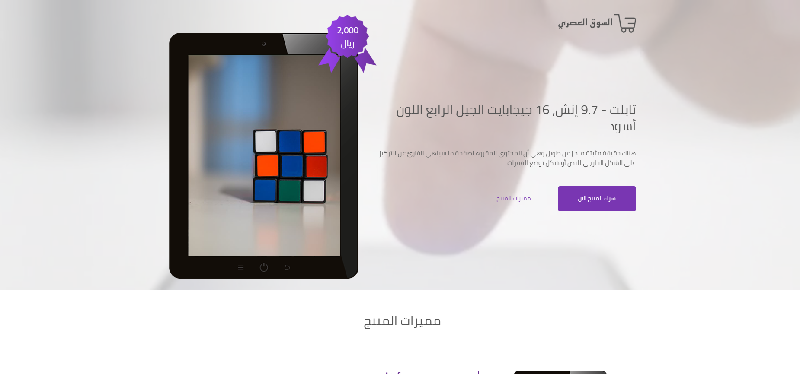

# Product Landing Page
---

<a name="english"></a>

### 📌 About the Project
**My Product** is a single-page responsive web interface designed to present a product (such as a smart device or digital product) to potential customers. 
The main focus of this project is applying **Bootstrap 5** grid systems, RTL layout adjustments, clean typography, and interactive UI components to deliver a straightforward and user-friendly browsing experience.

### 🚀 Live Demo
[View Live Demo](https://mohammed-MFSA99.github.io/my-product/)

### 📸 Screenshots
* **Desktop View**
  


### ✨ Features
- **Responsive RTL Layout:** Fully supports Arabic (Right-to-Left) layout across mobile, tablet, and desktop screens.
- **Product Showcase Sections:** Includes Hero section, Product Features, Video/Media preview, Pricing/Packages, Testimonials (Carousel), and a Contact form.
- **Form Validation:** Basic client-side validation for the contact/newsletter input fields using Bootstrap and JavaScript.
- **Clean & Organized Code:** Structured HTML5 semantics and custom CSS overrides.

### 🛠️ Technologies
- **HTML5**
- **CSS3**
- **Bootstrap 5 (RTL)**
- **JavaScript (ES6)**
- **Font Awesome** (for icons)

### 📂 Project Structure
```text
my-product/
│
├── asset/
│   ├── bootstrap/
│   │   ├── css/
│   │   │   └── bootstrap.rtl.min.css
│   │   └── js/
│   │       └── bootstrap.min.js
│   └── fontawsome/
│       ├── css/
│       │   └── all.min.css
│       └── webfonts/
│
├── css/
│   └── style.css
│
├── fonts/
│   └── Cairo-Regular.ttf
│
├── images/
│   ├── blog-1.png
│   ├── blog-2.png
│   ├── label.png
│   ├── logo.png
│   ├── product.png
│   ├── tablet-1.png
│   ├── tablet-2.png
│   └── tablet-3.png
│
├── js/
│   └── index.js
│
├── screenshots/
│   ├── desktop.png
│   └── mobile.png
│
├── videos/
│   ├── bg.mp4
│   └── video.mp4
│
├── index.html
└── README.md
```

### 📱 Responsive Design
The interface is tested and adjusted to work smoothly across:
- Desktop & Laptop screens
- Tablets
- Mobile devices

### 📚 What I Learned
Through building this landing page, I practiced:
- Structuring a complete landing page using semantic **HTML5**.
- Utilizing **Bootstrap 5 RTL** classes, grid system, utilities, and interactive components (like Carousels and Modals).
- Customizing Bootstrap's default styles with custom **CSS** while maintaining visual consistency.
- Implementing basic DOM manipulation and form validation with **JavaScript**.

### 🔮 Future Improvements
- Add smooth scroll animations when navigating between sections.
- Optimize image and video assets for faster page load times.


### 👨‍💻 Author
**Mohammed Faez**  
*Frontend Web Developer*
- **GitHub:** [@mohammed-MFSA99](https://github.com/mohammed-MFSA99)
- **LinkedIn**: [Mohammed Faez](https://www.linkedin.com/in/mohammed-faez-alameri)


<a name="arabic"></a>

<div dir="rtl">
<!-- 
### 📌 عن المشروع
مشروع **My Product** هو واجهة ويب من صفحة واحدة مصممة لاستعراض منتج ومميزاته للعملاء بشكل واضح ومرتب.
يركز المشروع بشكل أساسي على توظيف نظام الشبكة (Grid System) في **Bootstrap 5**، ودعم اتجاه الكتابة من اليمين لليسار (RTL)، وتنسيق الأقسام المختلفة لتعمل بسلاسة على مختلف أحجام الشاشات.


### ✨ المميزات
- **دعم كامل للغة العربية (RTL):** تصميم متجاوب يتكيف مع شاشات الهواتف، الأجهزة اللوحية، وأجهزة سطح المكتب.
- **أقسام متكاملة لعرض المنتج:** يحتوي على قسم ترحيبي (Hero Section)، مميزات المنتج، عرض مرئي (فيديو)، آراء العملاء (Carousel)، الأسعار، ونموذج تواصل.
- **التحقق من المدخلات (Form Validation):** التحقق من صحة البيانات المدخلة في نماذج الصفحة باستخدام Bootstrap و JavaScript.
- **كود منظم:** استخدام عناصر HTML5 الدلالية (Semantic Elements) مع فصل تنسيقات CSS المخصصة.

### 🛠️ التقنيات المستخدمة
- **HTML5**
- **CSS3**
- **Bootstrap 5 (RTL)**
- **JavaScript**
- **Font Awesome** (للأيقونات)

### 📂 هيكلة المشروع
<div dir="ltr">

```text
my-product/
│
├── asset/
│   ├── bootstrap/
│   │   ├── css/
│   │   │   └── bootstrap.rtl.min.css
│   │   └── js/
│   │       └── bootstrap.min.js
│   └── fontawsome/
│       ├── css/
│       │   └── all.min.css
│       └── webfonts/
│
├── css/
│   └── style.css
│
├── fonts/
│   └── Cairo-Regular.ttf
│
├── images/
│   ├── blog-1.png
│   ├── blog-2.png
│   ├── label.png
│   ├── logo.png
│   ├── product.png
│   ├── tablet-1.png
│   ├── tablet-2.png
│   └── tablet-3.png
│
├── js/
│   └── index.js
│
├── screenshots/
│   ├── desktop.png
│   └── mobile.png
│
├── videos/
│   ├── bg.mp4
│   └── video.mp4
│
├── index.html
└── README.md
```

</div>


### 📚 ماذا تعلمت من هذا المشروع؟
خلال تنفيذ هذا المشروع، قمت بالتدرب على:
- بناء هيكل صفحة هبوط كاملة باستخدام **HTML5**.
- التعامل مع إطار العمل **Bootstrap 5 (نسخة RTL)** واستخدام نظام الشبكة (Grid) والمكونات الجاهزة مثل الشرائح المنزلقة (Carousel).
- تخصيص مظهر عناصر Bootstrap باستخدام ملف **CSS** خارجي للحفاظ على هوية التصميم.
- التعامل مع عناصر الصفحة (DOM) وتفعيل التحقق من النماذج عبر **JavaScript**.

### 🔮 تحسينات مستقبلية
- إضافة تأثيرات حركية بسيطة (Animations) أثناء التمرير بين الأقسام.
- ضغط الصور والفيديوهات لتحسين سرعة تحميل الصفحة. -->


</div>
